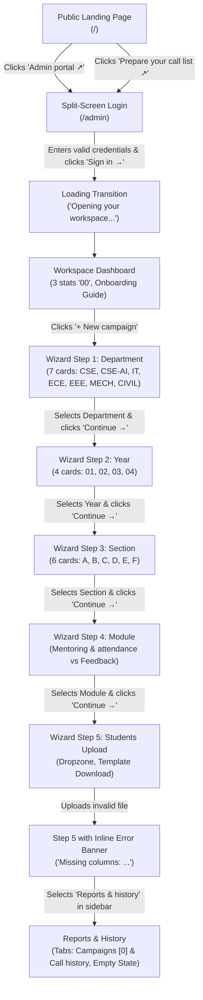

# Reference Analysis: "sohel-frontend_.mp4"

An exhaustive frame-by-frame interface and architectural analysis of the reference video `sohel-frontend_.mp4` (Duration: 65.5s, 1965 frames at 30.00 fps, resolution 1918x1010).

---

## 1. Screen Inventory in Order of Appearance

| Time Window | Route / URL | Screen Name | Key Elements & User Action |
| :--- | :--- | :--- | :--- |
| **00:00 - 00:12** | `http://127.0.0.1:5173/` | **Public Landing Page** | Top navigation bar with logo and "Admin portal ↗" button; hero section with eyebrow badge, large bold headline, primary CTA pill "Prepare your call list ↗", centered iPhone mockup with interactive card widgets and audio waveform, grayscale mountain landscape backdrop; horizontal 4-item stat strip; 3-card "A simple flow" section; 3-step issue resolution panel "Heard. Handled. Followed through."; institutional footer. User scrolls down and clicks "Admin portal ↗". |
| **00:12 - 00:22** | `http://127.0.0.1:5173/admin` | **Admin Login Page** | Split-screen layout (50/50). Left: grayscale mountain landscape with logo, eyebrow `VIIT · ADMIN WORKSPACE`, headline "A closer campus starts with you.", and 3-step numbered checklist. Right: white card with lock icon container, eyebrow `ADMIN PORTAL`, headline "Welcome back.", inputs for email (`you@college.edu`) and password (`Enter your password`) with leading icons and reveal toggle, black pill button "Sign in →", footer `🛡 Authorized administrators only`. User enters credentials and clicks "Sign in →". |
| **00:22 - 00:23** | `http://127.0.0.1:5173/admin` | **Loading Transition** | Centered logo emblem + text, animated spinner, caption "Opening your workspace...". |
| **00:23 - 00:26** | `http://127.0.0.1:5173/admin` | **Workspace Dashboard** | Sidebar with logo, `WORKSPACE` uppercase label, active "Dashboard" tab (soft blue tint), "+ New campaign" with `+` badge, "Reports & history", "• Saved on this device", "Visit homepage ↗", "Sign out →". Top breadcrumb `Workspace > Dashboard`, user badge `Administrator`. Header "Let's get connected.", three `00` stat cards (`Prepared campaigns`, `Student records`, `Completed calls`), guide panel "From student list to ready-to-go." with 3 checkable steps. User clicks "+ New campaign". |
| **00:26 - 00:28** | `http://127.0.0.1:5173/admin#new` | **Wizard Step 1: Department** | Stepper `1 Department` active with black pill and underline bar; `STEP 01 / 07`. Headline "Select a department.", subtitle "Start with the right team.". 3-column grid of 7 department cards: `CSE`, `CSE-AI`, `IT`, `ECE`, `EEE`, `MECH`, `CIVIL`. User selects `CSE` (turns light blue with checkmark `✓`). Continue is enabled. |
| **00:28 - 00:33** | `http://127.0.0.1:5173/admin#new` | **Wizard Step 2: Year** | Stepper `✓ Department` (green), `2 Year` active; `STEP 02 / 07`. Headline "Choose the year.", subtitle "Select the student batch.". Breadcrumb chip `CSE`. 4-column single-row grid of year cards with giant background numbers `01`, `02`, `03`, `04`, graduation cap icons, and labels `1st year`, `2nd year`, `3rd year`, `4th year`. Footer has `← Back`, center hint `Next: Section`, and disabled `Continue →` until selected. User selects `03 3rd year`. |
| **00:33 - 00:36** | `http://127.0.0.1:5173/admin#new` | **Wizard Step 3: Section** | Stepper `✓ Department`, `✓ Year`, `3 Section` active; `STEP 03 / 07`. Headline "Pick a section.", subtitle "Keep the conversation focused.". Breadcrumb `CSE / 3rd year`. 3x2 grid of 6 section cards: `A`, `B`, `C`, `D`, `E`, `F` with group icon and large bold letters. Footer has `← Back`, center hint `Next: Module`. User selects `F` and clicks `Continue →`. |
| **00:36 - 00:43** | `http://127.0.0.1:5173/admin#new` | **Wizard Step 4: Module** | Stepper `✓ Department`, `✓ Year`, `✓ Section`, `4 Module` active; `STEP 04 / 07`. Headline "Choose your module.", subtitle "Two paths. One connected campus.". Breadcrumb `CSE / 3rd year / Section F`. Two large cards: `Mentoring & attendance` (`Attendance, academics, and student support.`) and `Feedback` (`Class, hostel, and transport experiences.`). Footer has `← Back`, center hint `Next: Students`. User selects `Mentoring & attendance` and clicks `Continue →`. |
| **00:43 - 00:57** | `http://127.0.0.1:5173/admin#new` | **Wizard Step 5: Students** | Stepper `5 Students` active; `STEP 05 / 07`. Headline "Add your students.", subtitle "Upload, review, and confirm.". Breadcrumb `CSE / 3rd year / Section F / Attendance / mentoring`. Large dashed dropzone: upload icon, "Drop your student list here.", subtitle "CSV or Excel · Up to 5 MB · 5,000 students", black pill button "Browse files →", footer "📄 First worksheet only", "⭳ Download template". Footer shows disabled `Continue →` with helper text "Confirm your student list to continue.". User uploads a file with missing columns; an inline red/peach alert banner appears: `Missing columns: student_id, student_name, parent_name, phone. Use the downloadable template.`. |
| **00:57 - 01:05** | `http://127.0.0.1:5173/admin#reports` | **Reports & History** | User navigates via sidebar to "Reports & history". Headline "Reports & history.", subtitle "Campaigns, conversations, and their outcomes.". Top-right button "+ New campaign". Three stat cards (`Campaigns prepared 0`, `Calls completed 0`, `Responses collected 0`). Dual tabs: active `Campaigns 0` with black underline and inactive `Call history`. Search input `🔍 Search campaigns...` and dropdown `All modules ⌄`. Large empty state card: document icon, "No campaigns yet.", subtitle "Confirmed campaigns will appear here.". Institutional footer `VIIT AI Feedback` / `Department of CSE`. |

---

## 2. Flow Map & Interactivity

### Button Disabled States & Progression Rules:
1. **Wizard Step 1 (Department):** `Continue →` is disabled with a `not-allowed` cursor indicator until 1 department card is clicked.
2. **Wizard Step 2 (Year):** `Continue →` is disabled with a red `⊘` cursor indicator until 1 year card is clicked. Center hint reads `Next: Section`.
3. **Wizard Step 3 (Section):** `Continue →` is disabled until 1 section card is selected. Center hint reads `Next: Module`.
4. **Wizard Step 4 (Module):** `Continue →` is disabled until either `Mentoring & attendance` or `Feedback` is selected. Center hint reads `Next: Students`.
5. **Wizard Step 5 (Students):** `Continue →` is disabled with helper text `"Confirm your student list to continue."` below until a valid file is parsed and confirmed. When an error occurs, an inline alert banner displays the exact missing columns while keeping the dropzone fully operational.

---

## 3. Screen Layout & Component Specs

### A. Public Landing Page (`/`)
- **Header:** Sticky, backdrop blur, height 72px. Left: Logo icon + "VIIT AI Feedback" (`font-bold`, 16px) with "DEPARTMENT OF CSE" (10px, uppercase, tracking `0.15em`). Center: 3 text links (`Home`, `How it works`, `Issue resolution`). Right: Black pill button `Admin portal ↗`.
- **Hero Section:**
  - Background: Soft neutral off-white (`#F8FAFC`) with subtle grayscale landscape hill/mountain silhouette at the base.
  - Eyebrow Badge: White pill with green dot (`#10B981`) + text `VIIT · INTELLIGENT PARENT COMMUNICATION` (`font-mono`, 11px, tracking `0.15em`).
  - Headlines: `Connect with parents.` / `Listen. Act. Resolve.` in display bold (`font-black`, 56px desktop, line-height 1.05).
  - Subtitle: `Student updates. Parent feedback. One connected campus.` (16px, text-gray-500).
  - Primary CTA: Black pill button `Prepare your call list ↗` (padding `12px 24px`, rounded full).
  - Center Mockup: iPhone frame (320px width), dark dynamic island, "9:41" clock, audio waveform with cyan bars (`#0498ED`), language switcher `English` / `తెలుగు`, transcript card with pagination dots.
  - Floating Card Left: `Student data, ready.` with cyan sheet icon and checkmark.
  - Floating Card Right: `Every conversation counts.` with green checkmark and `Ready for Excel ↗` link.
  - Floating Card Bottom-Left: `A familiar conversation` with `文A` icon.
  - Floating Card Bottom-Right: `A concern? We follow through.` with peach bell icon.
- **Stat Strip:** Full-width light border, flex row of 4 items with icons: `👥 1-5 simultaneous calls`, `🕒 ~ 1 minute conversations`, `文A Telugu & English`, `🔄 One retry if unanswered`.
- **"A simple flow" Section:**
  - Eyebrow: `FROM DATA TO DIALOGUE`
  - Headline: `A simple flow.` / `A meaningful connection.`
  - Subtitle: `Attendance updates or honest feedback. Every call starts with the right context.`
  - 3-Column Card Grid: Card 01 (`Start with student data`), Card 02 (`Prepare the conversation` with tags `[Attendance / mentoring] [Feedback]`), Card 03 (`Everything in view`).
- **"Heard. Handled. Followed through." Section:**
  - Left column: Headline, narrative body, 3 owner pills with icons: `🎓 College coordinator`, `🏢 Hostel dean`, `🚌 Bus correspondent`.
  - Right column: Soft gray card container housing 3 action steps: `Alert the right owner`, `Address the concern`, `Call back. Confirm. Close.`. Subtitle note: `🔄 Still unresolved? Follow up again.`.

### B. Split-Screen Login (`/admin` or `/login`)
- **Left Panel (50% desktop):**
  - Grayscale mountain landscape gradient.
  - Logo + "VIIT AI Feedback" / "DEPARTMENT OF CSE" in white/black.
  - Eyebrow: `VIIT · ADMIN WORKSPACE`.
  - Headline: `A closer campus starts with you.` (Display bold, 48px).
  - 3-Step Checklist: `01 Choose your class`, `02 Prepare your campaign`, `03 Keep it all in view`.
  - Footer: `Student updates. Meaningful connections.`.
- **Right Panel (50% desktop):**
  - Clean white surface, centered max-width 420px.
  - Top link: `← Back to home`.
  - Icon container: Soft gray rounded square with lock icon `🔒`.
  - Eyebrow: `ADMIN PORTAL`.
  - Headline: `Welcome back.`.
  - Subtitle: `Sign in to your workspace.`.
  - Form Fields:
    - Email address with leading `✉` icon and placeholder `you@college.edu`.
    - Password with leading `🔒` icon, placeholder `Enter your password`, and trailing `👁` toggle.
  - Submit: Black pill button `Sign in →`.
  - Footer: `🛡 Authorized administrators only`.

### C. Workspace Shell & Dashboard
- **Sidebar (Width 256px / `w-64`):**
  - Brand header with waveform logo and institutional subtitle.
  - Eyebrow: `WORKSPACE` (uppercase, 11px, tracking `0.15em`, gray-400).
  - Navigation links:
    - `[ ⊞ ] Dashboard` (active: background `#EFF6FF`, text `#014A97`, rounded 10px).
    - `[ + ] New campaign` with trailing rounded `+` badge icon.
    - `[ 📊 ] Reports & history`.
    - Extended workspace links for extra roles: `[ 🔔 ] Issues` (with orange ping dot), `[ 👥 ] Users & classes`, `[ ⚙ ] Settings`.
  - Bottom block:
    - `• Saved on this device` status pill.
    - `Visit homepage ↗`.
    - `Sign out →`.
- **Top Header:**
  - Breadcrumb: `Workspace > Dashboard`.
  - User block: Circle avatar `[ M ]` (or role initial), user title (`Administrator`), email address.
- **Dashboard Metrics:**
  - Eyebrow: `YOUR WORKSPACE, AT A GLANCE`.
  - Headline: `Let's get connected.`.
  - Subtitle: `A new conversation starts with a well-prepared campaign.`.
  - CTA Button: Black pill `+ New campaign`.
  - 3 Stat Cards (Grid cols 3):
    - `Prepared campaigns` (icon in top right, value `00`).
    - `Student records` (icon in top right, value `00`).
    - `Completed calls` (icon in top right, value `00`, caption `Calling not connected`).
  - Onboarding Guide Panel:
    - Soft gray hero card with title `From student list to ready-to-go.`, CTA pill `Create campaign ↗`.
    - Right side 3 checkable steps: `01 Select your class`, `02 Add your students`, `03 Make it yours`.

### D. New Campaign Wizard (7 Steps)
- **Top Header:** Eyebrow `NEW CAMPAIGN`, Headline (e.g. `Select a department.`), Subtitle, Top-right indicator `STEP 01 / 07`.
- **Stepper Bar:** 7 horizontal numbered items connected by thin baseline. Completed steps show a green circle with `✓`; the current step shows a black filled circle with a bottom underline indicator.
- **Breadcrumb Chips:** Selected parameters display as small tag chips (e.g., `CSE / 3rd year / Section F / Attendance / mentoring`).
- **Cards Grid:**
  - **Step 1 (Department):** 3-col grid with 7 cards (`CSE`, `CSE-AI`, `IT`, `ECE`, `EEE`, `MECH`, `CIVIL`). Building icon, code, full name, top-right radio circle.
  - **Step 2 (Year):** 4-col single row with giant watermark numbers `01`, `02`, `03`, `04`, graduation cap icons, and batch labels (`1st year` to `4th year`).
  - **Step 3 (Section):** 3x2 grid with 6 cards (`A`, `B`, `C`, `D`, `E`, `F`), people icon, uppercase `SECTION`, and large bold letter.
  - **Step 4 (Module):** 2 large cards: `Mentoring & attendance` (`Attendance, academics, and student support.`) and `Feedback` (`Class, hostel, and transport experiences.`).
  - **Step 5 (Students):** Large dashed dropzone with upload icon, `Drop your student list here.`, `CSV or Excel · Up to 5 MB · 5,000 students`, `Browse files →`, `📄 First worksheet only`, `⭳ Download template`. Inline error banner when columns are missing.
- **Footer Navigation Bar:**
  - Left: `← Back` (light gray pill button).
  - Center: Dynamic hint (e.g. `Next: Section`, `Next: Module`, `Next: Students`, or `Confirm your student list to continue.`).
  - Right: `Continue →` (black pill button, disabled until step criteria are satisfied).

### E. Reports & History
- **Header:** `Reports & history.` / `Campaigns, conversations, and their outcomes.`, top-right `+ New campaign`.
- **Stat Cards (3 cards):** `Campaigns prepared (0)`, `Calls completed (0)`, `Responses collected (0)`.
- **Tabs:** `Campaigns 0` (active with bottom underline) and `Call history`.
- **Filter Row:** Search input `🔍 Search campaigns...` and dropdown `All modules ⌄`.
- **Empty State Card:** White rounded card with soft border, center document icon, title `No campaigns yet.`, subtitle `Confirmed campaigns will appear here.`.
- **Footer:** `VIIT AI Feedback` (left) / `Department of CSE` (right).

---

## 4. Visual Language & Style Attributes
- **Typography:** Inter / system geometric sans. Display headings (`font-bold`, `tracking-tight`), eyebrow labels (`font-mono`, uppercase, `tracking-[0.15em]`, 10–11px).
- **Corner Radii:** Cards 16px (`rounded-2xl`), buttons full pill (`rounded-full`) or 8–10px (`rounded-lg`), inputs 10px (`rounded-xl`).
- **Borders & Shadows:** Subtly tinted `border-border` (`#E2E8F0`), soft box shadow (`0 1px 3px rgba(0,0,0,0.05)`).
- **Illustrations:** Grayscale mountain/landscape topography rendered cleanly via CSS/SVG gradients. No external raster imagery.
- **Institutional Branding:** Employs VIIT primary navy (`#014A97`), deep ink dark (`#0B2038`), star cyan accent (`#0498ED`), and soft blue tint (`#EFF6FF`). Orange is strictly constrained to the issues loop and urgent alert badges.
